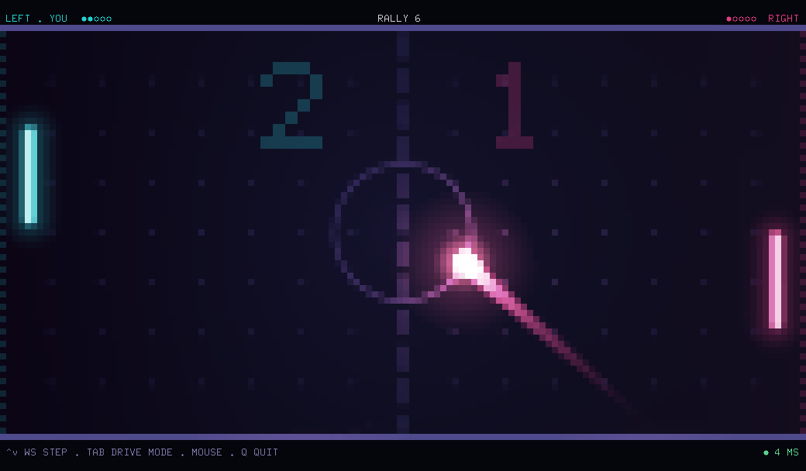

# socket-pong

A two-player Pong game in the terminal, with real-time networking and a full-colour pixel renderer.

Built to learn Bubble Tea and WebSocket through a small multiplayer project.



```bash
# Start the server
go run ./cmd/server

# Connect two players, each in a separate terminal
go run ./cmd/client

# No opponent around? Add a computer player
go run ./cmd/client -bot
```

The match starts when both players are connected. First to 5 wins. Use a terminal with true colour for the best picture.

## Controls

| Input | Action |
| --- | --- |
| Mouse | The paddle follows the pointer. The most precise option |
| `↑` `↓` / `W` `S` / `K` `J` | Move the paddle |
| `R` | Rematch, after the final point |
| `Tab` | Switch keyboard mode, on terminals that need it (see below) |
| `Q` / `Ctrl+C` | Quit |

Letter keys also work on a Russian keyboard layout.

### Keyboard modes

Many terminals report only key presses, never releases, and start repeating a held key after a long pause, often around 500 ms. The client detects what your terminal can do:

- **With release events** (the kitty keyboard protocol, or Windows Terminal) the paddle moves exactly while a key is held.
- **Without them** a tap moves one exact step, and a held key moves continuously once the terminal starts repeating it. `Tab` switches to drive mode: a press keeps the paddle moving until you press the opposite key.

The bottom line of the screen shows `STEP` or `DRIVE` when your terminal has no release events. The pause before a held key repeats comes from the OS and cannot be removed by a program, so on those terminals use the mouse or drive mode for fast movement.

## How it works

The server owns the match. It runs fixed-step physics at 120 Hz and sends snapshots at 60 Hz. Three things keep play smooth on top of that:

- **Your paddle does not wait for the network.** The client moves it immediately and reports the position. The server only checks that it could have been reached.
- **The ball is simulated, not replayed.** Both sides run the same physics from `internal/sim`, and the client follows the server's clock, so the ball flies in a straight line regardless of how packets arrive. Corrections blend in over a few frames.
- **Anti-aliased half-block pixels.** Each terminal cell shows two independently coloured pixels, and every shape is drawn with sub-pixel coverage, so objects glide instead of jumping between cells.

```text
cmd/server        match rules, fixed-step loop, one writer per player
cmd/client        terminal client and the -bot player
  input.go        keyboard and mouse to paddle movement
  net.go          socket goroutines and clock synchronisation
  world.go        ball prediction and reconciliation
  fx.go           sparks, shockwaves, wall pulses
  scene.go        draws the court, effects and HUD
  canvas.go       pixel buffer, shapes, conversion to terminal cells
internal/sim      physics shared by server and client
internal/protocol JSON messages
```

```bash
go test -race ./...
```
